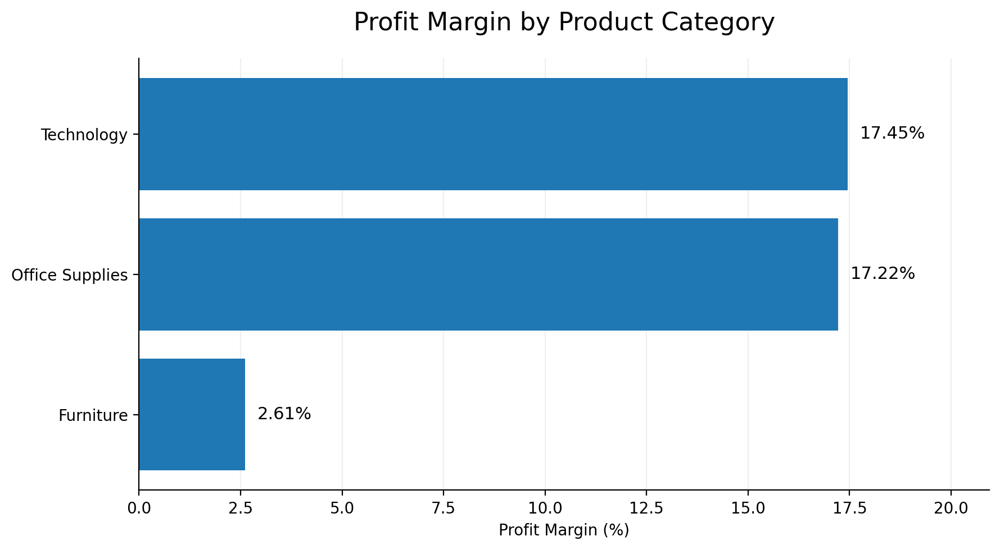
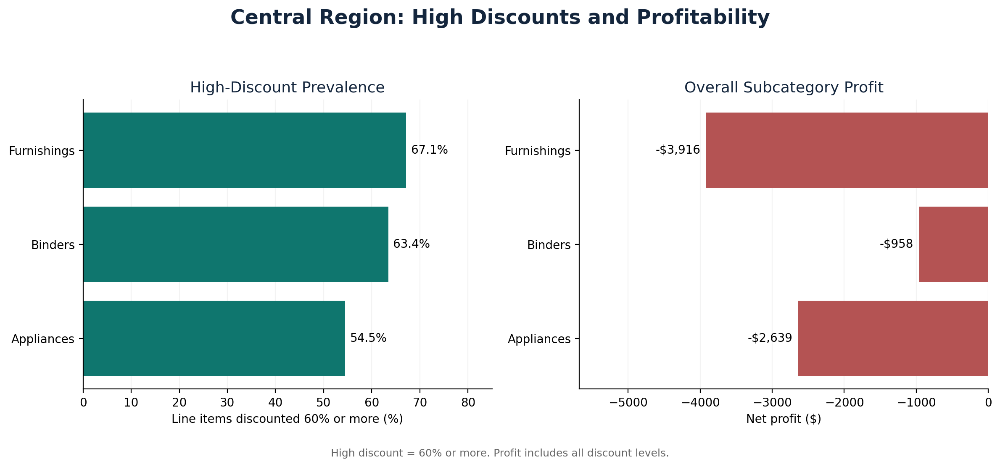
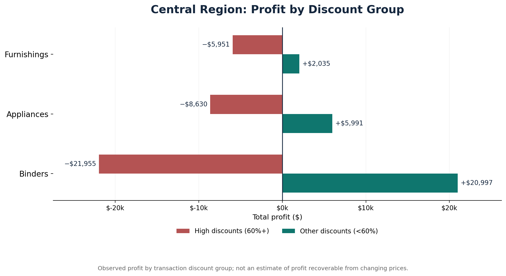
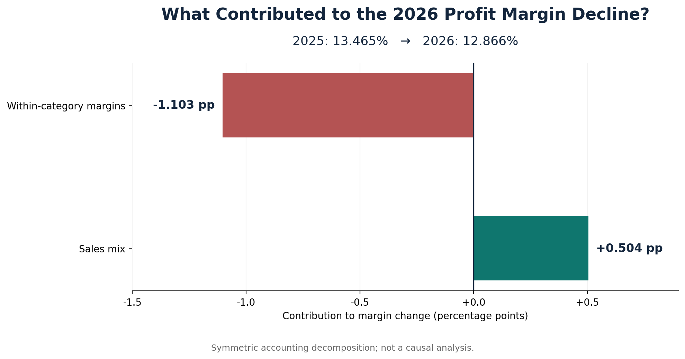
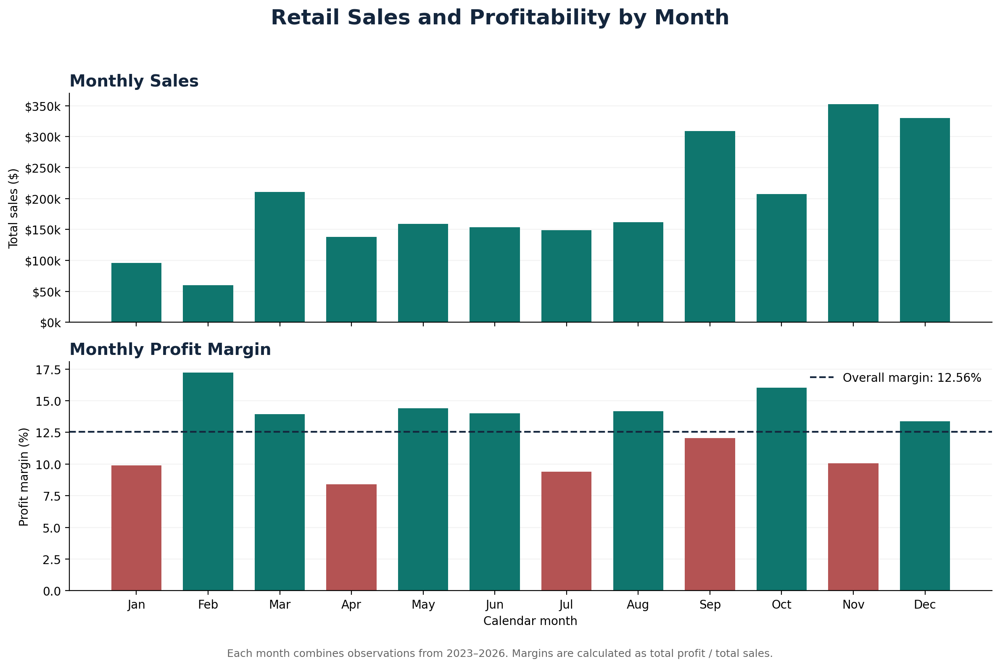
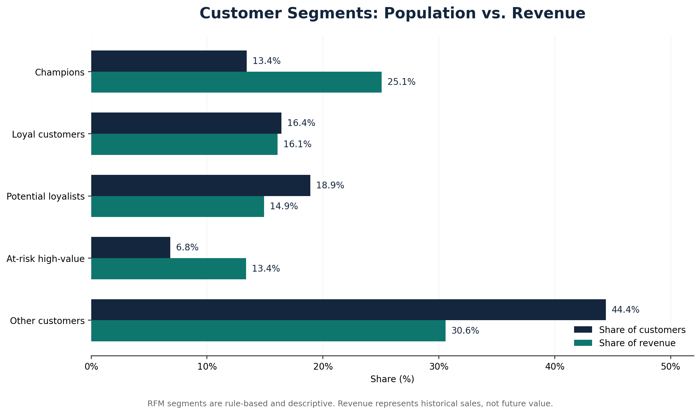
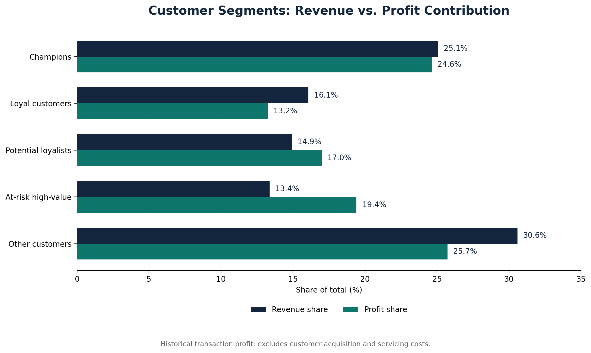

# Sales Performance Analysis

**An end-to-end retail business analytics case study using Python, statistical analysis, customer segmentation, and data visualization.**

## Project Overview

This project analyzes the Sample Superstore dataset to understand sales performance, identify profitability challenges, investigate discounting patterns, and evaluate customer purchasing behavior.

The goal is to translate transaction-level data into actionable business recommendations.

**Project status:** Analysis complete — final publication review.

## Business Questions

1. Which product categories and regions contribute most to revenue and profit?
2. Which products generate losses, and how are discounts associated with those losses?
3. What explains changes in profitability over time?
4. How do seasonal sales patterns relate to profit performance?
5. Which customer segments contribute the most revenue and profit?

## Dataset

- **Source:** [Tableau Public — Sample Data](https://public.tableau.com/app/learn/sample-data)
- **Dataset:** Superstore Sales (fictitious retail data)
- **Local workbook:** `Data/sample_-_superstore.xlsx` (not included in this repository)
- **Worksheet analyzed:** Orders
- **Period covered:** January 2023–December 2026
- **Sales line items:** 10,194
- **Distinct orders:** 5,111
- **Unique customers:** 804

The workbook is a sample dataset. Results should not be interpreted as current performance for a real retailer.

## Tools and Methods

- **Python:** Reproducible analysis scripts
- **Pandas and NumPy:** Data cleaning, aggregation, and calculations
- **Matplotlib:** Business-focused visualizations
- **Statsmodels:** Exploratory regression and sensitivity analysis
- **Excel / OpenPyXL:** Spreadsheet data processing
- **Git and GitHub:** Version control and documentation

Analytical methods include descriptive statistics, category and regional comparisons, discount-band analysis, statistical testing, profit margin decomposition, seasonal analysis, and RFM customer segmentation.

## Overall Business Performance

| Metric | Result |
|---|---:|
| Total sales | $2,326,534.35 |
| Total profit | $292,296.81 |
| Overall profit margin | 12.56% |
| Distinct orders | 5,111 |
| Unique customers | 804 |
| Average order value | $455.20 |

## Key Business Findings

### 1. Furniture has a profitability problem

| Category | Sales | Profit | Profit margin |
|---|---:|---:|---:|
| Furniture | $754,747.76 | $19,730.00 | 2.61% |
| Office Supplies | $731,893.31 | $126,023.44 | 17.22% |
| Technology | $839,893.28 | $146,543.38 | 17.45% |

Furniture generates substantial revenue but has a much lower profit margin than the other categories.

Tables are particularly concerning, generating a total loss of **$17,753.21**. Tables transactions discounted above 40% produced approximately **$11,108.50 in losses**.

### 2. Regional discounting is associated with losses

The Central region shows notable discounting and profitability challenges across several product subcategories.

High-discount transactions are associated with weaker profitability, although the relationship varies by product.

Exploratory regression and sensitivity analysis were used to investigate discount-profit relationships. These observational analyses do not establish causation.

### 3. Sales growth does not guarantee margin improvement

The overall profit margin declined by approximately **0.60 percentage points from 2025 to 2026**.

A category-level decomposition indicates that changes within category margins contributed approximately **-1.10 percentage points**, while shifts in category sales mix contributed approximately **+0.50 percentage points**.

This suggests that improving category-level profitability deserves attention alongside revenue growth.

### 4. Seasonal sales patterns should be evaluated alongside profit

Monthly sales and profitability patterns were analyzed to identify periods of stronger demand and differences in profit performance.

The results emphasize the importance of evaluating both revenue and margins rather than treating high-sales months as automatically successful.

### 5. Customer segments differ in revenue and profit contribution

Customers were segmented using **RFM analysis**:

- **Recency:** How recently a customer purchased
- **Frequency:** How often a customer purchased
- **Monetary value:** How much a customer spent

The analysis identified five descriptive segments: Champions, Loyal Customers, Potential Loyalists, At-risk High-value Customers, and Other Customers.

The **55 at-risk high-value customers** represent approximately:

- **6.8%** of customers
- **13.4%** of sales
- **19.4%** of transaction profit

This segment has an **18.23% profit margin**, making it an important group for further customer-retention investigation.

RFM segments are rule-based descriptions of historical purchasing behavior, not validated churn predictions.

## Business Recommendations

1. **Review Furniture pricing and discount policies**, especially for Tables and other loss-making subcategories.
2. **Investigate Central-region discount practices** to understand whether promotions are producing sufficient incremental value.
3. **Track profit margins alongside sales growth**, with category-level monitoring to identify deteriorating profitability.
4. **Use seasonal trends for planning**, while evaluating promotional periods on both revenue and profit.
5. **Prioritize further investigation of at-risk high-value customers**, particularly their purchasing history and retention opportunities.

These are evidence-informed recommendations for further business evaluation, not proven causal interventions.

## Project Structure

- `Data/` — Original Excel dataset
- `scripts/` — Python analysis and visualization scripts
- `outputs/` — Charts, CSV summaries, and analysis results
- `docs/` — Research findings and methodology
- `requirements.txt` — Python dependencies
- `README.md` — Project overview and key findings

## Dataset Setup

Download the **Superstore Sales** dataset from [Tableau Public Sample Data](https://public.tableau.com/app/learn/sample-data).

Create a folder named `Data` in the project directory and save the Excel workbook as `Data/sample_-_superstore.xlsx`.

The workbook is not included in this repository. The analysis scripts expect this exact file path and an `Orders` worksheet.

## How to Run the Project

**1. Clone the repository**

`git clone https://github.com/sphoorthi-munnangi/sales-performance-analysis.git`

`cd sales-performance-analysis`

**2. Install dependencies**

Python 3 is required.

`python3 -m pip install -r requirements.txt`

**3. Run the main analysis**

`python3 scripts/sales_analysis.py`

**4. Run additional analyses**

`python3 scripts/customer_segmentation.py`

`python3 scripts/customer_segment_profitability.py`

`python3 scripts/plot_customer_segments.py`

`python3 scripts/plot_customer_profit_contribution.py`

Run scripts that generate CSV summaries before visualization scripts that depend on those summaries.

For the full analytical discussion, see [Research Findings](docs/analysis_findings.md).

## Limitations

- The dataset is a sample and may not represent real-world retail operations.
- The workbook includes dates through December 2026; these are dataset dates, not evidence of observed future business performance.
- Discount-profit relationships are observational and do not establish causation.
- RFM scores and customer segments depend on the selected reference date and segmentation rules.
- Customer profitability reflects transaction-level profit and excludes acquisition and servicing costs.
- Results are descriptive and should not be interpreted as validated forecasts.

## Author

**Sphoorthi Munnangi**

[Portfolio](https://sphoorthi-munnangi.github.io/) | [LinkedIn](https://www.linkedin.com/in/sphoorthi-munnangi)